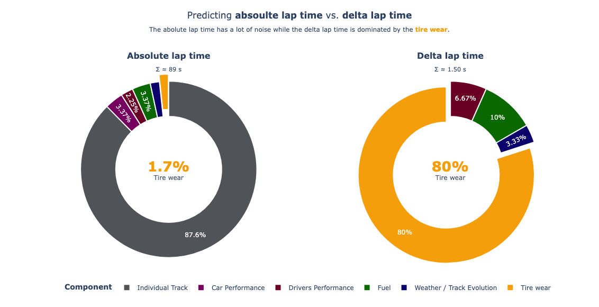
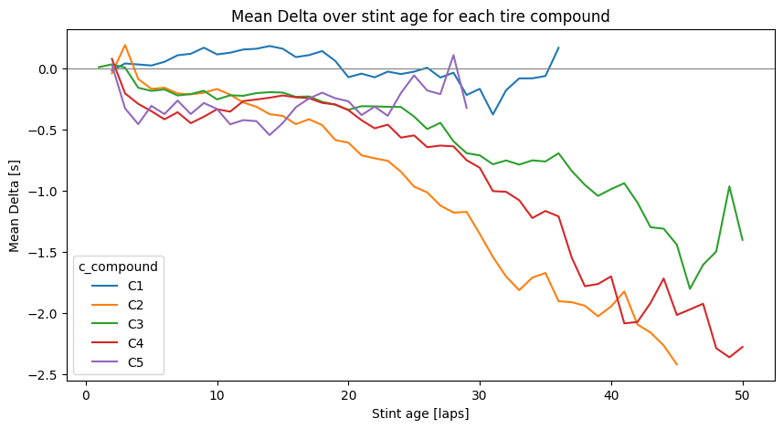
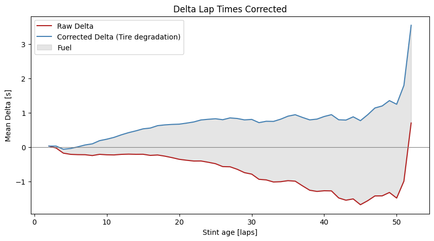
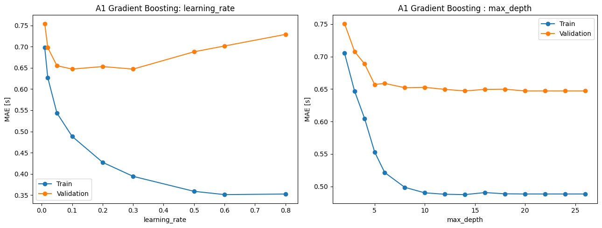
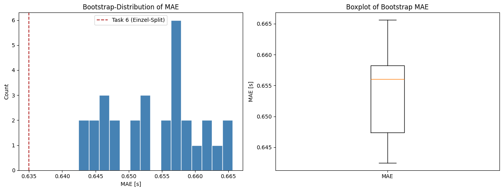

# Predicting Tyre Degradation in Formula 1

A regression model that forecasts how a driver's lap time develops over a
tyre stint. Built on three full seasons (2023–2025) of race data from the
free [OpenF1](https://openf1.org) API, it gives a race engineer a
data-driven estimate of tyre-related pace loss, the key input for deciding
*when* a pit stop pays off.

The project was created as the portfolio exam for the *Machine Learning*
module (MADS-ML, summer semester 2026) of the Data Science master's
programme.

> The notebooks are written in German. The dashboard and the presentation
> charts are in English.

---

## The idea: predict the delta, not the lap time

An absolute lap time of ~90 s is dominated by effects that have nothing to do
with the tyres: the circuit layout, the car, the driver, the set-up. Tyre wear
contributes only about 1–2 seconds over a whole stint.

Instead of predicting the raw lap time, the model predicts the **delta to a
stint reference**, defined as the median of the first three laps of the stint:

```
delta = lap_duration − median(lap_duration of stint laps 1–3)
```

Everything that stays constant within a stint (track, car, driver, set-up)
cancels out. What remains is how the pace *changes* over the stint, which is
exactly the question the race engineer needs answered.



<sub>Illustrative breakdown used in the project pitch.</sub>

---

## Data

| | |
|---|---|
| Source | OpenF1 REST API (`sessions`, `laps`, `stints`, `weather`, `drivers`, `race_control`) |
| Scope | All 70 races of the 2023–2025 seasons (Imola 2023 was cancelled and is excluded) |
| Granularity | One row = one race lap of one driver, ~77,000 laps |
| Enrichment | Absolute Pirelli compound codes (C1–C6) per race, taken from official Pirelli press releases (`data/tyre_c_codes.csv`) |
| After cleaning | 60,736 laps in 2,970 stints |

Laps are removed when they are in-laps or out-laps, run under safety car,
virtual safety car, yellow or red flag, driven in the rain or on
intermediate/wet tyres, belong to the first race lap or to stints of five
laps or fewer, or when their delta is an extreme outlier.

`assembly.ipynb` fetches the raw API responses once, caches them in
`data/raw/` and merges them into `data/dataset.csv`. All files are included,
so the experiments run fully offline.

---

## Method

1. **Target construction**: stint-internal delta as described above.
2. **Features**: stint age, tyre age at stint start, absolute compound
   (C1–C6), air and track temperature, humidity, race progress, track,
   team, season, driver.
3. **Split**: 50 / 25 / 25 train / validation / test, **grouped by stint**.
   All laps of a stint share the same reference lap, so a random lap-wise
   split would leak information into the test set.
4. **Models**
   - B1: mean predictor (`DummyRegressor`)
   - B2: linear regression
   - A1: `HistGradientBoostingRegressor`
   - A2: `KNeighborsRegressor` (with standardised features)
5. **Hyperparameter tuning**: validation curves to locate the optimum region,
   then `GridSearchCV` on the fixed validation split.
6. **Model assessment**: stint-level bootstrap (resampling whole stints) on
   train + validation, evaluated on the held-out test set.

Metrics: **MAE** in seconds (directly interpretable for the race engineer)
and **R²**.

---

## Results

| Model | MAE default [s] | R² default | MAE tuned [s] | R² tuned |
|---|---:|---:|---:|---:|
| B1 Mean predictor | 0.884 | 0.00 | – | – |
| B2 Linear regression | 0.778 | 0.22 | – | – |
| A1 Gradient Boosting | 0.642 | 0.45 | **0.635** | **0.46** |
| A2 k-Nearest Neighbors | 0.844 | 0.06 | 0.674 | 0.39 |

The tuned gradient boosting model (`learning_rate=0.12`, `max_depth=8`) was
selected as final model. The bootstrap confirms its stability:
**MAE 0.654 ± 0.007 s** (95 % CI 0.644–0.665), **R² 0.427 ± 0.013**.

The notebook closes with a critical reflection: the error of ~0.65 s per lap
is of the same order as the degradation signal itself, so the prediction is
best read as a trend over several laps rather than a lap-exact forecast.

<table>
  <tr>
    <td></td>
    <td></td>
  </tr>
  <tr>
    <td></td>
    <td></td>
  </tr>
</table>

---

## Repository layout

```
.
├── assembly.ipynb          Data acquisition from OpenF1 and dataset assembly
├── experiments.ipynb       Main notebook: context, EDA, modelling, tuning,
│                           bootstrap, reflection
├── data/
│   ├── raw/                Cached OpenF1 responses per race session
│   ├── tyre_c_codes.csv    Pirelli C1–C6 compound mapping per session
│   └── dataset.csv         Assembled lap-level dataset
├── dashboard/
│   └── app.py              Streamlit app explaining the delta approach
├── presentation/
│   ├── presentation.pptx   Project pitch
│   └── presentation.ipynb  Plotly charts used in the pitch
└── docs/figures/           Figures from the experiments notebook
```

---

## Getting started

Developed with Python 3.14.

```bash
python -m venv .venv
source .venv/bin/activate
pip install -r requirements.txt
```

Open the notebooks:

```bash
jupyter lab
```

Run the dashboard:

```bash
cd dashboard
streamlit run app.py
```

Re-running `assembly.ipynb` uses the cached responses in `data/raw/`. Only
sessions missing from the cache are requested from the API.

---

## Data sources

- Race data: [OpenF1](https://openf1.org), freely available without an API key.
- Tyre compound allocations: [Pirelli press releases](https://press.pirelli.com).

This project is not affiliated with Formula 1, the FIA, any F1 team or Pirelli.
